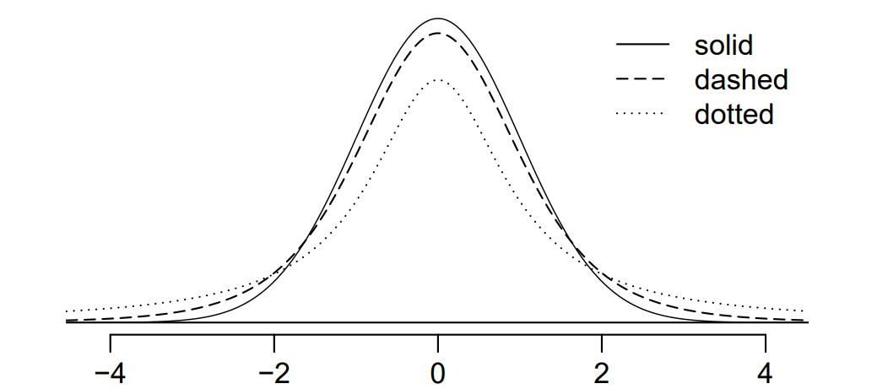
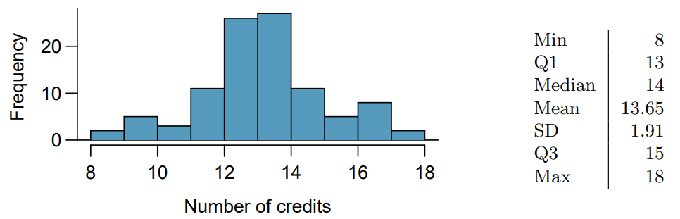

## Ejercicio 1

::: {.block fill="luma(246)" inset="8pt" radius="2pt" stroke="(left: 2pt + luma(45))"}
**5.8 Usuarios de Twitter y noticias, Parte I.** Una encuesta realizada en 2013 encontró que el 52% de los usuarios adultos de Twitter en EE. UU. obtiene al menos algunas noticias en Twitter.$^{12}$ El error estándar de esta estimación fue de 2.4%, y se puede usar una distribución normal para modelar la proporción muestral. Construye un intervalo de confianza del 99% para la fracción de usuarios adultos de Twitter en EE. UU. que obtienen algunas noticias en Twitter, e interpreta el intervalo de confianza en contexto.
:::

### Solución

La estimación es $\hat{p} = 0.52$, su error estándar es $EE = 0.024$ y el valor crítico para un 99% de confianza es $z^* = 2.576$. El intervalo se calcula como

$$
\hat{p} \pm z^* EE
= 0.52 \pm 2.576(0.024)
= (0.4582,\ 0.5818).
$$

```{r}
proporcion = 0.52
error_estandar = 0.024
nivel_confianza = 0.99

z_critico = qnorm(1 - (1 - nivel_confianza) / 2)
margen_error = z_critico * error_estandar
intervalo = c(
  inferior = proporcion - margen_error,
  superior = proporcion + margen_error
)

round(c(z_critico = z_critico, margen_error = margen_error, intervalo), 4)
```

Con un 99% de confianza, la fracción de adultos usuarios de Twitter en Estados Unidos que obtiene al menos algunas noticias por Twitter se encuentra entre 45.82% y 58.18%.

## Ejercicio 2

::: {.block fill="luma(246)" inset="8pt" radius="2pt" stroke="(left: 2pt + luma(45))"}
**6.34 Venado ladrador.** Se examinaron los factores del microhábitat asociados con los sitios de forrajeo y de descanso del venado ladrador en la isla de Hainan, China. En esta región, los bosques representan el 4.8% del terreno, las parcelas de pasto cultivado el 14.7% y los bosques caducifolios el 39.6%. De los 426 sitios donde los venados se alimentan, 4 fueron clasificados como bosques, 16 como parcelas de pasto cultivado y 61 como bosques caducifolios. La siguiente tabla resume estos datos.$^{39}$
:::

| Bosques | Parcela de pasto cultivado | Bosques caducifolios | Otro | Total |
|:-------:|:--------------------------:|:--------------------:|:----:|:-----:|
|    4    |             16             |          61          | 345  |  426  |

::: {.block fill="luma(246)" inset="8pt" radius="2pt" stroke="(left: 2pt + luma(45))"}
(a) Escribe las hipótesis para probar si los venados ladradores prefieren forrajear en ciertos hábitats sobre otros.

(b) ¿Qué tipo de prueba podemos usar para responder a esta pregunta de investigación?

(c) Verifica si se cumplen los supuestos y las condiciones requeridas para esta prueba.

(d) ¿Estos datos proporcionan evidencia convincente de que los venados ladradores prefieren forrajear en ciertos hábitats sobre otros? Realiza una prueba de hipótesis apropiada para responder a esta pregunta de investigación.
:::

**(a) Hipótesis**

Sea $p_i$ la proporción de sitios de alimentación en el hábitat $i$. Las hipótesis son

$$
H_0: (p_{\text{bosque}}, p_{\text{pastizal}}, p_{\text{deciduo}}, p_{\text{otro}})
= (0.048,\ 0.147,\ 0.396,\ 0.409)
$$

$$
H_A: \text{al menos una de las proporciones es diferente.}
$$

**(b) Tipo de prueba**

Se utiliza una prueba de bondad de ajuste de chi-cuadrada, porque se comparan las frecuencias observadas en categorías con las proporciones esperadas según la disponibilidad de cada hábitat.

**(c) Condiciones**

Las condiciones son:

1.  **Independencia:** Cada caso que contribuya a las frecuencias de la tabla debe ser independiente de todos los demás casos incluidos en ella.
2.  **Tamaño de la muestra y distribución:** Cada celda de la tabla debe tener una frecuencia esperada de al menos 5.

Cada sitio se clasifica en un solo tipo de hábitat. Para la condición de independencia, se supone que los 426 sitios son independientes porque el enunciado no da información sobre esto. Bajo $H_0$, las frecuencias esperadas se obtienen multiplicando cada proporción por 426:

$$
E_i = n p_i.
$$

```{r}
observados = c(Bosque = 4, Pastizal = 16, Deciduo = 61, Otro = 345)
proporciones = c(Bosque = 0.048, Pastizal = 0.147,
                 Deciduo = 0.396, Otro = 0.409)

n = sum(observados)
esperados = n * proporciones
round(esperados, 2)
```

Las frecuencias esperadas son 20.45, 62.62, 168.70 y 174.23; todas son mayores que 5, por lo que se cumple la condición de tamaño para la aproximación chi-cuadrada.

**(d) Prueba de hipótesis**

Primero obtenemos las frecuencias esperadas bajo $H_0$:

$$
\begin{aligned}
E_{bosque} &= 426(0.048) = 20.448, \\
E_{pastizal} &= 426(0.147) = 62.622, \\
E_{deciduo} &= 426(0.396) = 168.696, \\
E_{otro} &= 426(0.409) = 174.234.
\end{aligned}
$$

El estadístico de prueba suma, para cada categoría, la diferencia cuadrática entre la frecuencia observada $O_i$ y la esperada $E_i$, dividida entre la esperada:

$$
\begin{aligned}
\chi^2
&= \frac{(4 - 20.448)^2}{20.448}
 + \frac{(16 - 62.622)^2}{62.622} \\
&\quad + \frac{(61 - 168.696)^2}{168.696}
 + \frac{(345 - 174.234)^2}{174.234} \\
&= 13.2305 + 34.7100 + 68.7534 + 167.3670 \\
&= 284.0609 \approx 284.06.
\end{aligned}
$$

```{r}
contribuciones = (observados - esperados)^2 / esperados
round(c(contribuciones, chi_cuadrada = sum(contribuciones)), 4)

prueba = chisq.test(x = observados, p = proporciones)
prueba
```

El estadístico es $\chi^2 = 284.06$, con $gl = 4 - 1 = 3$ y un valor $p < 2.2 \times 10^{-16}$. Como el valor $p$ es muy pequeño, se rechaza $H_0$. Esto indica que los venados no utilizan las hábitats en proporción a la superficie que ocupa cada uno, la mayor diferencia se observa en la categoría “Otro”, con 345 sitios observados frente a 174.23.

## Ejercicio 3

::: {.block fill="luma(246)" inset="8pt" radius="2pt" stroke="(left: 2pt + luma(45))"}
**6.36 Escáner de cuerpo completo, Parte II.** La siguiente tabla resume un conjunto de datos que encontramos por primera vez en el Ejercicio 6.26 sobre opiniones acerca de los escáneres de cuerpo completo y la afiliación política. Las diferencias en cada grupo político pueden deberse al azar. Realiza los siguientes cálculos bajo la hipótesis nula de independencia entre la afiliación partidista de un individuo y su apoyo a los escáneres de cuerpo completo. Puede ser útil agregar primero una columna adicional para los totales de las filas antes de continuar con los cálculos.
:::

|   |   | **Afiliación partidista** |   |   |
|:---|:---|:--:|:--:|:--:|
|  |  | **Republicano** | **Demócrata** | **Independiente** |
|  | Debería | 264 | 299 | 351 |
| *Respuesta* | No debería | 38 | 55 | 77 |
|  | No sabe / No responde | 16 | 15 | 22 |
|  | **Total** | 318 | 369 | 450 |

::: {.block fill="luma(246)" inset="8pt" radius="2pt" stroke="(left: 2pt + luma(45))"}
(a) ¿Cuántos republicanos esperarías que no apoyaran el uso de escáneres de cuerpo completo?

(b) ¿Cuántos demócratas esperarías que apoyaran el uso de escáneres de cuerpo completo?

(c) ¿Cuántos independientes esperarías que no supieran o no respondieran?
:::

### Solución

Bajo la hipótesis de independencia, la afiliación partidista y la opinión sobre los escáneres no están asociadas. Por ello, la proporción de respuestas en cada categoría sería la misma entre los partidos. La frecuencia esperada en la fila $i$ y la columna $j$ se calcula multiplicando la proporción de la fila por el total de la columna:

$$
\begin{aligned}
E_{ij}
&= n P(\text{respuesta } i) P(\text{partido } j) \\
&= n\left(\frac{R_i}{n}\right)
     \left(\frac{C_j}{n}\right) \\
&= \frac{R_i C_j}{n},
\end{aligned}
$$

donde $R_i$ es el total de la fila, $C_j$ es el total de la columna y $n$ es el total general. Al sumar la tabla, los totales de las respuestas son 914, 170 y 53; los totales por partido son 318, 369 y 450; y $n = 1137$.

```{r}
tabla = matrix(
  c(264, 299, 351,
     38, 55, 77,
     16, 15, 22),
  nrow = 3,
  byrow = TRUE,
  dimnames = list(
    Respuesta = c("Debería (Apoya)", "No debería (No apoya)", "No sabe / No responde"),
    Partido = c("Republicano", "Democrata", "Independiente")
  )
)

addmargins(tabla)
esperados = outer(rowSums(tabla), colSums(tabla)) / sum(tabla)
round(esperados, 2)
```

**(a) Republicanos que no apoyarían**

Se usa el total de la fila “No debería” y el total de la columna “Republicano”:

$$
E_{\text{no debería, republicano}}
= \frac{(170)(318)}{1137}
= \frac{54060}{1137}
\approx 47.55.
$$

**(b) Demócratas que apoyarían**

Se usa el total de la fila “Debería” y el total de la columna “Demócrata”:

$$
E_{\text{debería, demócrata}}
= \frac{(914)(369)}{1137}
= \frac{337266}{1137}
\approx 296.63.
$$

**(c) Independientes que no saben o no responden**

Se usa el total de la fila “No sabe / No responde” y el total de la columna “Independiente”:

$$
E_{\text{no sabe, independiente}}
= \frac{(53)(450)}{1137}
= \frac{23850}{1137}
\approx 20.98.
$$

Por lo tanto, se esperarían aproximadamente 47.55 republicanos que no apoyan, 296.63 demócratas que apoyan y 20.98 independientes que no saben o no contestan.

## Ejercicio 4

::: {.block fill="luma(246)" inset="8pt" radius="2pt" stroke="(left: 2pt + luma(45))"}
**7.2 t-distribution**. La figura de la derecha muestra tres curvas unimodales y simétricas: la distribución normal estándar (z), la distribución t con 5 grados de libertad y la distribución t con 1 grado de libertad. Determina cuál es cuál y explica tu razonamiento.
:::

{fig-align="center" width="75%"}

### Solución

Las tres distribuciones son unimodales, simétricas y están centradas en cero. La distribución normal estándar tiene colas más delgadas que las distribuciones $t$. Las distribuciones $t$ tienen colas más pesadas, y esta diferencia es más marcada cuando hay menos grados de libertad. Al aumentar los grados de libertad, la distribución $t$ se aproxima a la normal estándar.

En la figura, la curva sólida tiene el pico más alto y colas más delgadas, por lo que corresponde a la distribución normal estándar ($z$). La curva punteada tiene el pico más bajo y las colas más pesadas, por lo que corresponde a la distribución $t$ con 1 grado de libertad. La curva discontinua tiene una forma intermedia y corresponde a la distribución $t$ con 5 grados de libertad.

Esto concuerda con el uso de la distribución $t$: al estimar la desviación estándar poblacional con la desviación estándar muestral, se incorpora incertidumbre adicional. Con pocos grados de libertad, esa incertidumbre produce colas más pesadas; con más grados de libertad, su forma se acerca a la normal estándar.

## Ejercicio 5

::: {.block fill="luma(246)" inset="8pt" radius="2pt" stroke="(left: 2pt + luma(45))"}
**7.50 Créditos universitarios.** Un consejero universitario está interesado en estimar cuántos créditos suele cursar un estudiante en cada semestre. El consejero decide tomar una muestra aleatoria de 100 estudiantes utilizando la base de datos del registro escolar. El siguiente histograma muestra la distribución del número de créditos cursados por estos estudiantes. También se proporcionan estadísticos muestrales para esta distribución.
:::

{fig-align="center" width="92%"}

::: {.block fill="luma(246)" inset="8pt" radius="2pt" stroke="(left: 2pt + luma(45))"}
(a) ¿Cuál es la estimación puntual del promedio de créditos cursados por semestre por los estudiantes de esta universidad? ¿Y de la mediana?

(b) ¿Cuál es la estimación puntual de la desviación estándar del número de créditos cursados por semestre por los estudiantes de esta universidad? ¿Y del rango intercuartílico (IQR)?

(c) ¿Es una carga de 16 créditos inusualmente alta para esta universidad? ¿Y una de 18 créditos? Explica tu razonamiento.

(d) El consejero toma otra muestra aleatoria de 100 estudiantes y esta vez obtiene una media muestral de 14.02 unidades. ¿Debería sorprenderse de que este estadístico muestral sea ligeramente diferente del de la muestra original? Explica tu razonamiento.

(e) Las medias muestrales anteriores son estimaciones puntuales de la media de créditos cursados por todos los estudiantes de esa universidad. ¿Qué medida usamos para cuantificar la variabilidad de esta estimación? Calcula esta cantidad usando los datos de la muestra original.
:::

### Solución

**(a) Estimaciones puntuales**

La mejor estimación puntual del promedio de créditos es la media muestral, $\bar{x} = 13.65$. La estimación puntual de la mediana es 14 créditos.

**(b) Desviación estándar e intervalo intercuartílico**

La estimación puntual de la desviación estándar es $s = 1.91$ créditos. El intervalo intercuartílico es

$$
IQR= Q_3 - Q_1 = 15 - 13 = 2 \text{ créditos}.
$$

**(c) Cargas de 16 y 18 créditos**

$$
\begin{aligned}
z &= \frac{x-\mu}{\sigma} = \frac{16-13.65}{1.91} \approx 1.23 \\[10pt]
z &= \frac{x-\mu}{\sigma} = \frac{18-13.65}{1.91} \approx 2.28
\end{aligned}
$$

- Una carga de 16, no es inusualmente alta, ya que está a solo 1.23 desviaciones estándar por encima de la media (dentro del límite normal de 2 SD).

- Una carga de 18 créditos, sí es inusualmente alta, dado que supera las 2 desviaciones estándar respecto a la media

**(d) Diferencia entre las medias muestrales**

La diferencia entre las medias es $14.02 - 13.65 = 0.37$ créditos. No es sorprendente que dos muestras aleatorias produzcan medias distintas., dado que los estimadores puntuales se calculan a partir de muestras y están sujetos a la variabilidad muestral asi que es completamente normal que diferentes muestras aleatorias arrojen medias muestrales ligeramente distintas

**(e) Variabilidad de la media muestral**

La variabilidad de la media muestral se cuantifica con su error estándar:

$$
EE_{\bar{x}} = \frac{s}{\sqrt{n}} = \frac{1.91}{\sqrt{100}} = 0.191 \text{ créditos}.
$$

En muestras aleatorias de 100 estudiantes, las medias muestrales suelen variar alrededor de 0.191 créditos respecto de la media poblacional.

### Comprobación con R

```{r}
media_muestral = 13.65
mediana_muestral = 14
s = 1.91
n = 100
q1 = 13
q3 = 15

iqr = q3 - q1
z_16 = (16 - media_muestral) / s
z_18 = (18 - media_muestral) / s
diferencia_medias = 14.02 - media_muestral
error_estandar_media = s / sqrt(n)

resultados = data.frame(
  calculo = c("Media muestral", "Mediana muestral", "Desviacion estandar",
              "IQR", "z para 16 creditos", "z para 18 creditos",
              "Diferencia entre medias", "Error estandar de la media"),
  valor = c(media_muestral, mediana_muestral, s, iqr, z_16, z_18,
            diferencia_medias, error_estandar_media)
)

resultados$valor = round(resultados$valor, 2)
resultados
```
