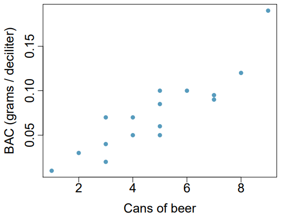
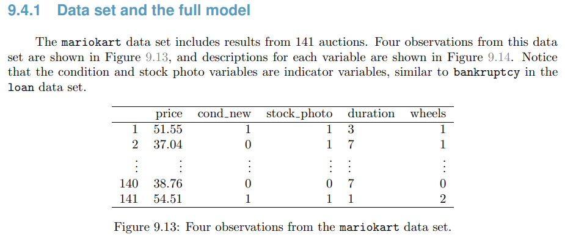
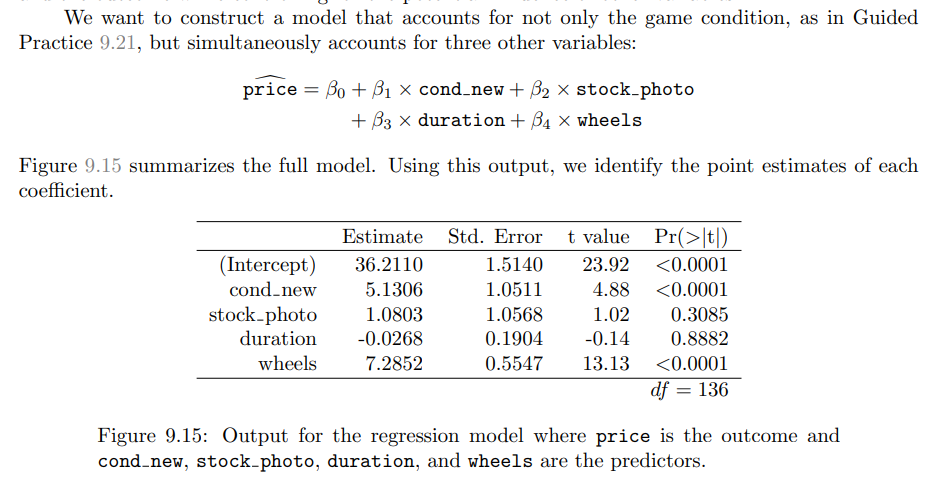

## Ejercicio 1

::: {.block fill="luma(246)" inset="8pt" radius="2pt" stroke="(left: 2pt + luma(45))"}
**8.32 Cerveza y concentración de alcohol en la sangre.** Muchas personas creen que el género, el peso, los hábitos de consumo y otros factores son más importantes para predecir la concentración de alcohol en la sangre (BAC) que considerar simplemente cuántas bebidas consumió una persona. Aquí se examinan datos de 16 estudiantes voluntarios de Ohio State University, cada uno de los cuales bebió una cantidad de latas de cerveza asignada al azar. Los estudiantes se dividieron por igual entre hombres y mujeres, y diferían en peso y hábitos de consumo. Treinta minutos después, un agente midió su concentración de alcohol en la sangre, en gramos de alcohol por decilitro de sangre. El diagrama de dispersión y la tabla de regresión resumen los resultados.

(a) Describe la relación entre el número de latas de cerveza y la concentración de alcohol en la sangre.

(b) Escribe la ecuación de la recta de regresión e interpreta la pendiente y el intercepto en contexto.

(c) ¿Los datos proporcionan evidencia convincente de que beber más latas de cerveza está asociado con un aumento en la concentración de alcohol en la sangre? Escribe las hipótesis nula y alternativa, reporta el valor p y presenta tu conclusión.

(d) El coeficiente de correlación entre el número de latas de cerveza y la concentración de alcohol en la sangre es 0.89. Calcula e interpreta $R^2$ en contexto.

(e) Supón que visitamos un bar, preguntamos a las personas cuántas bebidas han consumido y también medimos su concentración de alcohol en la sangre. ¿Crees que la relación entre el número de bebidas y la concentración de alcohol sería tan fuerte como la que se encontró en el estudio de Ohio State? Explica.
:::

{fig-align="center"}

| Coeficiente | Estimación | Error estándar | Estadístico $t$ | Valor $p$ |
|:------------|-----------:|---------------:|----------------:|----------:|
| Intercepto  |    -0.0127 |         0.0126 |           -1.00 |    0.3320 |
| beers       |     0.0180 |         0.0024 |            7.48 |    0.0000 |

### Solución

**(a) Relación entre las variables**

El diagrama de dispersión muestra una asociación positiva y aproximadamente lineal: al aumentar el número de latas de cerveza, también tiende a aumentar la concentración de alcohol en la sangre. La relación es fuerte.

**(b) Recta de regresión**

La ecuación estimada es

$$
\widehat{BAC} = -0.0127 + 0.0180(\text{beers}).
$$

Por cada lata adicional de cerveza, la concentración de alcohol en la sangre aumenta en promedio $0.0180$ gramos por decilitro. El intercepto indica una concentración estimada de $-0.0127$ gramos por decilitro cuando no se han consumido latas. Como es una concentración negativa no es posible, el intercepto su interpretación no es práctica en este contexto.

**(c) Prueba de hipótesis**

Sea $\beta_1$ la pendiente poblacional entre el número de latas de cerveza y la concentración de alcohol en la sangre. Las hipótesis para evaluar si existe una asociación positiva son

$$
H_0: \beta_1 = 0
\qquad\text{y}\qquad
H_A: \beta_1 > 0.
$$

La pendiente estimada es $0.0180$, con $t = 7.48$. El valor $p$ aparece como 0.0000 por redondeo; en realidad, es menor que 0.0001. Se rechaza $H_0$, los datos proporcionan evidencia convincente de una asociación positiva entre el número de latas de cerveza y la concentración de alcohol en la sangre.

**(d) Coeficiente de determinación**

$$
R^2 = (0.89)^2 = 0.7921.
$$

El 79.21 % de la variabilidad en la concentración de alcohol en la sangre se explica por su relación lineal con el número de latas de cerveza. En otras palabras, a mayor número de latas de cerveza consumidas, generalmente mayor será la concentración de alcohol en la sangre.

**(e) Comparación con una muestra en un bare**

Es probable que la relación no sea tan fuerte en una muestra de personas en un bar. En el estudio de Ohio State, la cantidad de cerveza se asignó al azar. En un bar, las personas deciden cuánto beber y pueden diferir en peso, género, alimentos consumidos y otros factores. Esas diferencias pueden agregar variabilidad a la relación entre el número de bebidas y la concentración de alcohol en la sangre.

## Ejercicio 2

::: {.block fill="luma(246)" inset="8pt" radius="2pt" stroke="(left: 2pt + luma(45))"}
**9.6 Árboles de cerezo.** El rendimiento de madera es aproximadamente igual al volumen de un árbol, pero este valor es difícil de medir sin talarlo. En su lugar, otras variables, como la altura y el diámetro, pueden utilizarse para predecir el volumen y el rendimiento de un árbol. Para estudiar la relación entre estas variables, investigadores recopilaron datos de 31 árboles de cerezo negro del bosque nacional Allegheny, en Pensilvania. La altura se mide en pies, el diámetro en pulgadas (a una altura de 54 pulgadas del suelo) y el volumen en pies cúbicos.

El siguiente resumen corresponde a un modelo de regresión lineal que utiliza la altura y el diámetro para predecir el volumen.

(a) Calcula un intervalo de confianza del 95% para el coeficiente de altura e interprétalo en contexto.

(b) Un árbol de esta muestra mide 79 pies de altura, tiene un diámetro de 11.3 pulgadas y un volumen de 24.2 pies cúbicos. Determina si el modelo sobreestima o subestima el volumen de este árbol y por cuánto.
:::

| Coeficiente | Estimación | Error estándar | Estadístico $t$ | Valor $p$ |
|:------------|-----------:|---------------:|----------------:|----------:|
| Intercepto  |     -57.99 |           8.64 |           -6.71 |      0.00 |
| height      |       0.34 |           0.13 |            2.61 |      0.01 |
| diameter    |       4.71 |           0.26 |           17.82 |      0.00 |

### Solución

**(a) Intervalo de confianza para el coeficiente de altura**

Hay 31 árboles y el modelo estima tres coeficientes: intercepto, altura y diámetro. Por tanto, los grados de libertad son $31 - 3 = 28$. Con los de la tabla,

$$
\begin{aligned}
\hat{\beta}_{height} \pm t^* EE
&= 0.34 \pm t_{0.975,\,28}(0.13) \\
&= 0.34 \pm 2.048(0.13) \\
&\approx (0.074,\ 0.606).
\end{aligned}
$$

Con un 95% de confianza, al mantener constante el diámetro, cada pie adicional de altura está asociado con un aumento promedio de entre 0.074 y 0.606 pies cúbicos en el volumen del árbol.

**(b) Volumen estimado**

La ecuación estimada para el volumen es

$$
\widehat{volumen} = -57.99 + 0.34(\text{height}) + 4.71(\text{diameter}).
$$

Para un árbol de 79 pies de altura y 11.3 pulgadas de diámetro,

$$
\begin{aligned}
\widehat{volumen}
&= -57.99 + 0.34(79) + 4.71(11.3) \\
&= 22.093 \text{ pies cúbicos}.
\end{aligned}
$$

El residuo es el volumen observado menos el estimado:

$$
24.2 - 22.093 = 2.107 \text{ pies cúbicos}.
$$

Como el volumen observado es mayor que el estimado, el modelo subestima el volumen del árbol por aproximadamente 2.11 pies cúbicos.

## Ejercicio 3

::: {.block fill="luma(246)" inset="8pt" radius="2pt" stroke="(left: 2pt + luma(45))"}
**Figura 9.15. Modelo de regresión múltiple para las subastas de Mario Kart.** Usando R, reproduce el modelo de la figura con el conjunto de datos disponible en <https://www.openintro.org/data/csv/mariokart.csv>.
:::

{fig-align="center"}

{fig-align="center"}

### Solución

#### Interpretación de la Figura 9.15

En la tabla de la Figura 9.15, cada coeficiente describe cómo cambia el precio estimado de la subasta cuando varía una de las variables predictoras, manteniendo constantes las demás. Así, el coeficiente de *cond_new* (5.1306) indica que un juego nuevo tiene un precio estimado aproximadamente 5.13 dólares mayor que uno usado. El coeficiente de *wheels* (7.2852) indica que cada unidad adicional de esta variable se asocia con un aumento promedio de 7.29 dólares en el precio. Ambos coeficientes son estadísticamente significativos ($p < 0.0001$).

En cambio, *stock_photo* tiene un coeficiente de 1.0803 ($p = 0.3085$) y *duration*, de -0.0268 ($p = 0.8882$). Como sus valores $p$ superan el nivel de significancia de 0.05, estos resultados no aportan evidencia suficiente de una asociación entre esas variables y el precio, una vez controladas las demás. El intercepto estimado es de 36.2110 dólares; representa el precio estimado cuando todos los predictores valen cero, una combinación que no tiene una interpretación práctica clara para estas subastas.

#### Replicación del modelo en R

Para replicar el ajuste de la Figura 9.15, se descargan los datos y se ajusta un modelo de regresión lineal múltiple con las mismas cuatro variables predictoras. En el código, *cond_new* y *stock_photo* se codifican como indicadores: toman el valor 1 cuando el juego es nuevo o hay una foto del producto, respectivamente, y 0 en caso contrario.

```{r}
mariokart = "https://www.openintro.org/data/csv/mariokart.csv" |> read.csv()

mariokart |>  names()
# mariokart |>  head()


mariokart = mariokart |> 
  dplyr::mutate(
    cond = dplyr::if_else(
      condition = cond == "new",
      true = 1,
      false = 0
    ),
    stock_photo = dplyr::if_else(
      condition = stock_photo == "yes",
      true = 1,
      false = 0
    ),
  ) |> 
  dplyr::select(total_pr, cond, stock_photo, duration, wheels) |> 
  dplyr::rename(
    price = total_pr,
    cond_new = cond
  )

mariokart |>  head()

modelo_mariokart = lm( price ~ cond_new + stock_photo + duration + wheels, data = mariokart )


modelo_mariokart |>  summary()
```

El ajuste reproducido no arroja los mismos resultados que la Figura 9.15: el conjunto descargado contiene 143 observaciones, mientras que el modelo del libro se basa en 141. Por ello, los coeficientes y sus valores $p$ difieren. Los párrafos anteriores interpretan la tabla del libro; a continuación se interpreta la salida del modelo ajustado con los datos descargados.

En esta salida, el coeficiente de *cond_new* es 2.5816. Manteniendo constantes las demás variables, el precio estimado de un juego nuevo es 2.58 dólares mayor que el de uno usado; sin embargo, el valor $p$ es 0.6222, así que no hay evidencia estadística suficiente de una diferencia en el precio. El coeficiente de *stock_photo* es -6.7542 y el de *duration* es 0.3788, pero sus valores $p$ (0.1938 y 0.6872, respectivamente) también superan 0.05. Por tanto, este ajuste no proporciona evidencia suficiente de una asociación entre esas variables y el precio, una vez consideradas las demás.

Por su parte, *wheels* tiene un coeficiente de 9.9476: cada unidad adicional se asocia con un aumento promedio estimado de 9.95 dólares en el precio, manteniendo constantes los otros predictores. Esta asociación es estadísticamente significativa ($p = 0.000359$). El intercepto, 40.9385 dólares, corresponde al caso en que todos los predictores valen cero; como en la tabla del libro, no tiene una interpretación práctica clara para estas subastas.

La prueba global del modelo también es significativa ($F = 4.86$, $p = 0.001069$), lo que indica que, en conjunto, las variables predictoras aportan información sobre el precio. El coeficiente de determinación es $R^2 = 0.1235$, por lo que el modelo explica el 12.35 % de la variación observada en los precios de esta muestra; el $R^2$ ajustado es 0.09808 (aproximadamente 9.81 %).

```{r}
cat("Observaciones de la muestra: ", mariokart |>  nrow())
```

## Ejercicio 4

::: {.block fill="luma(246)" inset="8pt" radius="2pt" stroke="(left: 2pt + luma(45))"}
**9.16 Desastre del Challenger, Parte I.** El 28 de enero de 1986 se esperaba un lanzamiento rutinario del transbordador espacial *Challenger*. Setenta y tres segundos después del despegue, el transbordador se desintegró y murieron los siete tripulantes. La investigación se centró en la falla de un sello crítico llamado anillo O. Se planteó que el daño en estos anillos durante el lanzamiento podía estar relacionado con la temperatura ambiente. La tabla resume los datos observacionales de los anillos O en 23 misiones. El orden de las misiones se basa en la temperatura del lanzamiento. *Temperature* es la temperatura en grados Fahrenheit, *Damaged* es el número de anillos O dañados y *Undamaged* es el número de anillos O no dañados.

|   Misión    |   1 |   2 |   3 |   4 |   5 |   6 |   7 |   8 |   9 |  10 |  11 |  12 |
|:-----------:|----:|----:|----:|----:|----:|----:|----:|----:|----:|----:|----:|----:|
| Temperature |  53 |  57 |  58 |  63 |  66 |  67 |  67 |  67 |  68 |  69 |  70 |  70 |
|   Damaged   |   5 |   1 |   1 |   1 |   0 |   0 |   0 |   0 |   0 |   0 |   1 |   0 |
|  Undamaged  |   1 |   5 |   5 |   5 |   6 |   6 |   6 |   6 |   6 |   6 |   5 |   6 |

|   Misión    |  13 |  14 |  15 |  16 |  17 |  18 |  19 |  20 |  21 |  22 |  23 |
|:-----------:|----:|----:|----:|----:|----:|----:|----:|----:|----:|----:|----:|
| Temperature |  70 |  70 |  72 |  73 |  75 |  75 |  76 |  76 |  78 |  79 |  81 |
|   Damaged   |   1 |   0 |   0 |   0 |   0 |   1 |   0 |   0 |   0 |   0 |   0 |
|  Undamaged  |   5 |   6 |   6 |   6 |   6 |   5 |   6 |   6 |   6 |   6 |   6 |

(a) Cada columna de la tabla representa una misión distinta del transbordador. Examina los datos y describe lo que observas sobre la relación entre la temperatura y el número de anillos O dañados.

(b) Las fallas se codificaron como 1 para un anillo O dañado y 0 para uno no dañado, y se ajustó un modelo de regresión logística a estos datos. El resumen del modelo se muestra a continuación. Describe en palabras sus componentes principales.

| Coeficiente | Estimación | Error estándar | Estadístico $z$ | Valor $p$ |
|:------------|-----------:|---------------:|----------------:|----------:|
| Intercepto  |    11.6630 |         3.2963 |            3.54 |    0.0004 |
| Temperature |    -0.2162 |         0.0532 |           -4.07 |    0.0000 |

(c) Escribe el modelo logístico usando las estimaciones de los parámetros.

(d) Con base en el modelo, ¿consideras justificadas las preocupaciones sobre los anillos O? Explica.
:::

### Solución

**(a) Relación entre temperatura y anillos O dañados**

Se observa una asociación negativa: en las misiones más frías hubo más anillos O dañados. A temperaturas más altas, la mayoría de las misiones no registró daños o tuvo uno solo.

**(b) Resumen del modelo**

El intercepto estimado, 11.6630, es el logaritmo de las probabilidades de daño cuando la temperatura es de 0 °F; esta temperatura queda fuera del rango observado, por lo que el intercepto no tiene una interpretación práctica directa. El coeficiente de temperatura es -0.2162: por cada aumento de 1 °F, el logaritmo de las probabilidades de daño disminuye en 0.2162, en promedio. En términos de *odds*, estas se multiplican por $\exp(-0.2162) \approx 0.806$, una disminución aproximada del 19.4% por cada grado Fahrenheit. El valor $p$ reportado para la temperatura es menor que 0.0001, lo que indica que existe evidencia estadísticamente significativa de que, a medida que aumenta la temperatura, disminuye la probabilidad de que ocurra un daño.

**(c) Modelo logístico**

Sea $\hat{p}$ la probabilidad estimada de que un anillo O resulte dañado. El modelo es

$$
\log\left(\frac{\hat{p}}{1-\hat{p}}\right)
= 11.6630 - 0.2162(\text{Temperature}).
$$

**(d) Conclusión**

Sí. El modelo indica que la probabilidad de daño aumenta cuando la temperatura disminuye, por lo que las preocupaciones sobre los anillos O están justificadas. Esta asociación no demuestra por sí sola causalidad, pero los datos muestran un patrón claro.

### Gráfica de los datos

```{r}
challenger = data.frame(
  Mision = 1:23,
  Temperatura = c(
    53, 57, 58, 63, 66, 67, 67, 67, 68, 69, 70, 70,
    70, 70, 72, 73, 75, 75, 76, 76, 78, 79, 81
  ),
  Danados = c(
    5, 1, 1, 1, 0, 0, 0, 0, 0, 0, 1, 0,
    1, 0, 0, 0, 0, 1, 0, 0, 0, 0, 0
  ),
  No_danados = c(
    1, 5, 5, 5, 6, 6, 6, 6, 6, 6, 5, 6,
    5, 6, 6, 6, 6, 5, 6, 6, 6, 6, 6
  )
)


plot(
  x = challenger$Temperatura,
  y = challenger$Danados,
  main = "Temperatura y anillos O dañados",
  xlab = "Temperatura al lanzamiento (°F)",
  ylab = "Anillos O dañados (de 6)",
  pch = 19,
)
```

La gráfica permite observar que las misiones con temperaturas más bajas tienden a presentar más anillos O dañados. El patrón general concuerda con la pendiente negativa del modelo logístico.

## Ejercicio 5

::: {.block fill="luma(246)" inset="8pt" radius="2pt" stroke="(left: 2pt + luma(45))"}
**9.18 Desastre del Challenger, Parte II.** El ejercicio 9.16 nos introdujo a los anillos O, los cuales fueron identificados como una posible explicación de la desintegración del transbordador espacial Challenger, 73 segundos después del despegue en 1986.

La investigación encontró que la temperatura ambiente al momento del lanzamiento estaba estrechamente relacionada con el daño de los anillos O, los cuales son un componente fundamental del transbordador.

{fig-align="center"}

(a) Los datos proporcionados en el ejercicio anterior se muestran en la gráfica. El modelo logístico ajustado a estos datos puede expresarse como:

$$ \log\left(\frac{\hat{p}}{1-\hat{p}}\right) =11.6630-0.2162\times \text{Temperatura} $$

donde $\hat{p}$ es la probabilidad estimada por el modelo de que un anillo O resulte dañado.

Utiliza el modelo para calcular la probabilidad de que un anillo O resulte dañado a las siguientes temperaturas ambiente: 51, 53 y 55 grados Fahrenheit.

Las probabilidades estimadas para otras temperaturas son:

$$
\begin{aligned}
\hat{p}_{57} &= 0.341 & \hat{p}_{59} &= 0.251\\
\hat{p}_{61} &= 0.179 & \hat{p}_{63} &= 0.124\\
\hat{p}_{65} &= 0.084 & \hat{p}_{67} &= 0.056\\
\hat{p}_{69} &= 0.037 & \hat{p}_{71} &= 0.024
\end{aligned}
$$

(b) Agrega al gráfico las probabilidades estimadas del inciso (a) y conecta estos puntos con una curva suave que represente las probabilidades estimadas por el modelo.

(c) Describe las posibles inquietudes respecto a la aplicación de la regresión logística en este caso y señala los supuestos necesarios para aceptar la validez del modelo.
:::

### Solución

**(a) Probabilidades estimadas**

Para obtener una probabilidad a partir del logaritmo de las probabilidades, se usa la transformación logística:

$$
\hat{p} = \frac{\exp(\eta)}{1+\exp(\eta)},
\qquad
\eta = 11.6630 - 0.2162(\text{Temperature}).
$$

Para 51 °F, $\eta = 0.6368$ y $\hat{p} \approx 0.654$. Para 53 °F, $\eta = 0.2044$ y $\hat{p} \approx 0.551$. Para 55 °F, $\eta = -0.2280$ y $\hat{p} \approx 0.443$. Las probabilidades estimadas disminuyen al aumentar la temperatura.

```{r}
modelo_logistico = glm(
  cbind(Danados, No_danados) ~ Temperatura,
  family = binomial(link = "logit"),
  data = challenger
)

summary(modelo_logistico)

temperaturas_estimadas = seq(51, 71, by = 2)

probabilidades_estimadas = predict(
  modelo_logistico,
  newdata = data.frame(Temperatura = temperaturas_estimadas),
  type = "response"
)

round(
  data.frame(
    Temperatura = temperaturas_estimadas,
    Probabilidad = probabilidades_estimadas
  ),
  digits = 3
)
```

**(b) Gráfica de las probabilidades**

```{r}
temperaturas_curva = seq(51, 81, length.out = 100)

probabilidades_curva = predict(
  modelo_logistico,
  newdata = data.frame(Temperatura = temperaturas_curva),
  type = "response"
)

plot(
  challenger$Temperatura,
  challenger$Danados / 6,
  main = "Probabilidad de daño de los anillos O",
  xlab = "Temperatura al lanzamiento (°F)",
  ylab = "Proporción de anillos O dañados",
  xlim = c(50, 82),
  ylim = c(0, 1),
  pch = 19,
  col = "grey40"
)

points(
  temperaturas_estimadas,
  probabilidades_estimadas,
  pch = 1
)

lines(
  temperaturas_curva,
  probabilidades_curva,
  lwd = 2
)

legend(
  "topright",
  legend = c("Proporción observada por misión", "Modelo logístico"),
  pch = c(19, NA),
  lty = c(NA, 1),
  bty = "n"
)
```

La curva muestra que la probabilidad estimada de daño disminuye rápidamente a medida que aumenta la temperatura. En las temperaturas más bajas del rango observado, el riesgo estimado es considerablemente mayor.

**(c) Supuestos y limitaciones**

El modelo supone que las misiones son independientes y que el logaritmo de las probabilidades de daño cambia linealmente con la temperatura. Los seis anillos de una misma misión comparten las condiciones del lanzamiento y sus resultados podrían no ser independientes. Además, solo se cuenta con 23 misiones y hay poca información en las temperaturas más bajas. La estimación para 51 °F queda por debajo de la temperatura mínima observada. Por estas razones, las estimaciones deben interpretarse con cautela.
